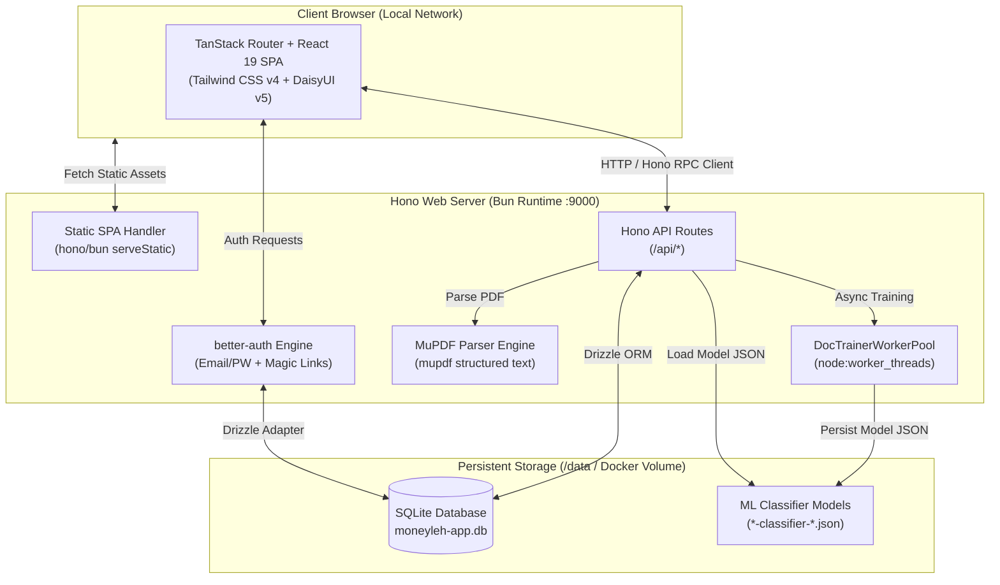
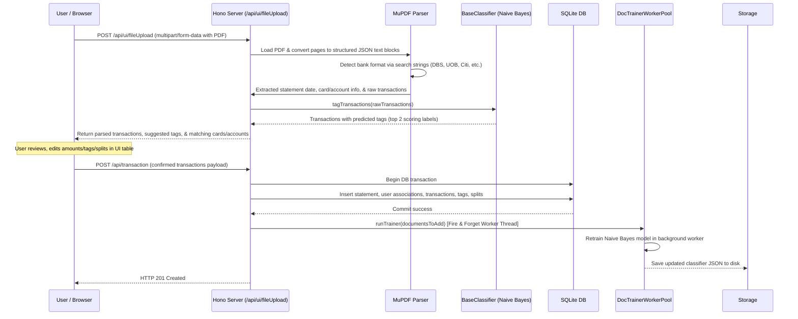

# AGENTS.md — Project Context & Developer Guide for Moneyleh

> **Note for AI Agents**: This document provides complete architectural, operational, and development context for `moneyleh-app`. Read this file to understand the system design, tech stack, data models, workflows, deployment, and coding conventions before making changes.

---

## 1. Project Overview

**Moneyleh** (`moneyleh-app`) is a self-hosted, privacy-first personal finance application tailored for Singapore banking and investment products. It is designed to run locally on a home network (e.g., home server, NAS, mini PC, or Raspberry Pi) via Docker, ensuring sensitive financial statements and transaction histories never leave the user's premises.

### Core Capabilities
- **Automated Statement Ingestion**: Parses PDF e-statements from major Singapore banks and institutions (DBS, UOB, Citibank, Standard Chartered, Trust Bank, GXS Bank, CPF, Chocolate Finance) and CSV uploads.
- **Intelligent Transaction Auto-Tagging**: Uses machine learning classifiers (Naive Bayes and K-Nearest Neighbors via Universal Sentence Encoder) running in background worker pools to categorize transactions automatically.
- **Account & Card Tracking**: Organizes cash accounts, brokerages, CPF balances, and credit cards (miles, cashback, rewards) by financial institution.
- **Household Expense Splitting**: Supports shared expense tracking and percentage-based splitting between household members, computing net balances owed and receivable.
- **Zero-Cloud Architecture**: Built with embedded SQLite (`bun:sqlite`), Bun runtime, and local static asset serving.

---

## 2. Tech Stack & Architecture



### Architecture Highlights
1. **Runtime**: **Bun** is the sole JS runtime, package manager, and test runner.
2. **Backend**: **Hono** framework (`src/index.ts`) running on Bun, listening on port `9000`.
3. **Frontend**: **React 19** with **TanStack Router** (file-based routing), **Vite**, **Tailwind CSS v4**, **DaisyUI v5**, **Chart.js**, and the **React Compiler** (`babel-plugin-react-compiler`).
4. **End-to-End Type Safety**: Frontend communicates with Hono using `@hono/client` (`hc<AppType>`, `hc<UiRouteType>`) directly referencing backend route types (`src/frontend/src/lib/backend-clients.ts`), eliminating manual API schema synchronization.
5. **Frontend Delivery**: The frontend is built into static assets (`src/frontend/dist`) and served directly by the Hono backend with an SPA fallback (`/*` -> `dist`, `*` -> `dist/index.html`). There is no separate Nginx or Node container.
6. **Database & ORM**: **SQLite** via `bun:sqlite` with **Drizzle ORM** (`drizzle-orm/bun-sqlite`) and `drizzle-kit` for migrations. Foreign keys are strictly enforced (`PRAGMA foreign_keys = ON`).
7. **Authentication**: **Better-Auth** (`better-auth`) with Drizzle adapter, password auth, role-based access control (`admin` / `user`), and magic link email delivery via Resend.
8. **Asynchronous ML Worker Pool**: ML classifier retraining runs in a dedicated worker pool (`DocTrainerWorkerPool` using `node:worker_threads`), preventing long-running model updates from blocking the main Hono request loop.

---

## 3. Repository Directory Structure

```
moneyleh-app/
├── Dockerfile                      # Multi-stage production build (oven/bun:1)
├── compose.yaml                    # Docker Compose config (service, ports, volumes)
├── package.json                    # Backend dependencies & scripts
├── bun.lock                        # Bun lockfile (root)
├── biome.json                      # Biome linter & formatter config
├── lefthook.yml                    # Git hooks (pre-commit check, pre-push build & test)
├── tsconfig.json                   # Root TypeScript config
├── drizzle.config.ts               # Drizzle Kit configuration (SQLite)
├── drizzle/                        # Drizzle SQL migration files
├── test-files/                     # Sample PDF/CSV statement test fixtures
├── scripts/                        # deploy_prod.sh, extract_db.sh
├── src/
│   ├── index.ts                    # Hono app, static SPA handler, worker pool, error boundary
│   ├── env.ts                      # Bun environment types
│   ├── errors.ts                   # Standard HTTP & PDF error definitions
│   ├── db/
│   │   ├── db.ts                   # Bun SQLite connection & Drizzle instance
│   │   ├── schema.ts               # Tables, relations & Zod schemas
│   │   ├── auth-schema.ts          # Better-Auth schema (user, session, account)
│   │   ├── company.seed.ts         # Predefined SG financial institutions
│   │   ├── seed.ts                 # Seeder (companies, cards, accounts, test user)
│   │   └── migrate.ts              # Migration runner
│   ├── lib/
│   │   ├── auth.ts / permissions.ts# Better-Auth config & RBAC roles
│   │   ├── dayjs.ts / logger.ts    # Extended Day.js & logger helper
│   │   ├── email.ts / test.utils.ts# Resend email & test utilities
│   │   ├── csv/                    # CSV direct upload parsing logic
│   │   ├── pdf/                    # MuPDF parser core & formats (DBS, UOB, Citi, SCB, Trust, GXS, CPF, Chocolate)
│   │   ├── descriptionTagger/      # Classifiers (Naive Bayes, KNN + USE, worker pool)
│   │   └── middleware/             # Hono Zod validator middleware
│   ├── routes/
│   │   ├── account.ts / card.ts    # /api/account, /api/card
│   │   ├── company.ts / tag.ts     # /api/company, /api/tag
│   │   ├── statement.ts            # /api/admin/statement
│   │   ├── transaction.ts          # /api/transaction (batch uploads, queries, splits)
│   │   ├── ui.ts                   # /api/ui (fileUpload, statement linking, availableInventory)
│   │   ├── route.types.ts          # Shared pagination and account/card schemas
│   │   ├── route.utils.ts          # Helpers (findUserOrThrow, cascade deletions)
│   │   └── transaction.utils.ts    # Split math & worker pool invocation
│   └── frontend/                   # React 19 + TanStack Router SPA subproject
│       ├── vite.config.ts          # Vite config (TanStack Router, React Compiler, Tailwind v4)
│       └── src/
│           ├── App.tsx / root.tsx  # Root React component & providers
│           ├── router.tsx          # TanStack router setup
│           ├── routeTree.gen.ts    # Auto-generated route tree
│           ├── routes/             # File routes (_authenticated, dashboard, inventory, split, login)
│           ├── components/         # Modals, tables, dialogs, charts
│           ├── context/ / hooks/   # AuthContext and custom hooks
│           └── lib/                # Hono RPC client (backend-clients.ts), auth-client
```

---

## 4. Database & Core Domain Models

The database is SQLite managed by Drizzle ORM (`src/db/schema.ts` and `src/db/auth-schema.ts`).

### Entity Relationship Overview

| Model | Purpose | Key Relations |
| :--- | :--- | :--- |
| `companies` | Financial institutions (DBS, UOB, OCBC, Citi, CPF, etc.) | One-to-many with `accounts`, `cards`, `securities`, `insurance_policies` |
| `accounts` | Bank, brokerage, CPF, or cash accounts | Belongs to `company`. Many-to-many with `user` via `user_accounts` |
| `cards` | Credit cards with reward types (`miles`, `cashback`, `rewards`) | Belongs to `company`. Many-to-many with `user` via `user_cards` |
| `statement_ownerships` | Maps string identifiers extracted from statements to specific `cardId` or `accountId` | Links statement text (e.g., `"DBS ALTITUDE VISA SIGNATURE"`) to internal card/account ID |
| `statements` | Uploaded statement records by date and user | Belongs to `user` and `statement_ownership` |
| `transactions` | Individual credit/debit transaction lines | Belongs to `user`, optionally `accountId` or `cardId` |
| `tags` | Categorization tags (e.g., `dining`, `groceries`, `transport`, `shopping`) | Many-to-many with `transactions` via `transaction_tags` |
| `transaction_shares` | Split expense records defining user ownership percentage (`share: 1-100%`) | Composite key `(transaction_id, user_id)` |
| `user` | Better-Auth user entity | Has many `accounts`, `cards`, `transactions`, `statements`, `transaction_shares` |

### Key Business Invariants
1. **Account vs. Card Constraint**: A transaction must belong to *either* an `accountId` *or* a `cardId`, never both and never neither (`refineAccountOrCardId` validator).
2. **Duplicate Statement Guard**: Uploading a statement with the same `statementDate`, `statementOwnershipId`, and `userId` is rejected with HTTP 400.
3. **Transaction Deletion Cascade**: Deleting an account or card cascades to delete associated `transaction_tags`, `transaction_statements`, `transaction_shares`, and `transactions` via `removeUserAssignments` in a SQLite transaction.

---

## 5. Key Workflows & Pipelines

### 5.1 Statement Upload & Ingestion Pipeline



### 5.2 Supported Statement Formats (`src/lib/pdf/formats/`)
- **DBS / POSB**: Consolidated credit card statements and bank account statements (Multiplier, My Account).
- **UOB**: Credit card statements and account statements (One Account, Stash).
- **Citibank**: Credit card statements (both standard format and headerless variant).
- **Standard Chartered (SCB)**: Credit card statements.
- **Trust Bank**: Cashback credit card statements.
- **GXS Bank**: Digital bank account statements.
- **CPF (Central Provident Fund)**: Consolidated yearly/monthly contribution statements (Ordinary, Medisave, Special, Investment).
- **Chocolate Finance**: Managed account statements.

### 5.3 Machine Learning Categorization (`src/lib/descriptionTagger/`)
- **`BaseClassifier`**: Facade supporting three underlying classifier implementations:
  1. `default-bayes` (*Active by default*): Custom lightweight Naive Bayes implementation (`naive-bayes-classifier.ts`).
  2. `natural-bayes`: Tokenizer and Bayes classifier from npm `natural`.
  3. `default-knn`: K-Nearest Neighbors classifier using TensorFlow.js (`@tensorflow/tfjs-node`) and Universal Sentence Encoder embeddings (`@tensorflow-models/universal-sentence-encoder`).
- **Worker Thread Isolation**: Training uses `DocTrainerWorkerPool` to prevent CPU-bound natural language processing and tensor calculations from blocking HTTP response handling.
- **Model Storage**: Classifiers serialize to JSON on disk at `CLASSIFIER_ROOT` (in Docker: `/data/default-bayes-classifier-*.json`).

### 5.4 Household Expense Splitting (`/split`)
- Transactions can be marked as split with another registered user.
- The `transaction_shares` table records each user's share (e.g. 50%).
- The endpoint `GET /api/transaction/split/:userId/summary` aggregates:
  - `totalAmountToPay`: Sum of owed shares for transactions paid by others for this user.
  - `totalAmountToReceive`: Sum of owed shares for transactions paid by this user for others.
  - `userDetails`: Other users involved in shared expenses.

---

## 6. API Route Reference

All backend endpoints are prefixed with `/api`.

| Route | Method | Purpose |
| :--- | :--- | :--- |
| `/api/auth/*` | `POST`, `GET` | Better-Auth authentication endpoints (login, register, magic link, session, admin) |
| `/api/company` | `GET`, `POST`, `PUT` | List, create, or update financial institutions |
| `/api/account/:userId` | `POST` | Create a new bank/financial account for a user |
| `/api/account/:userId/:accountId` | `DELETE` | Delete an account and cascade-remove its transactions |
| `/api/card/:userId` | `POST` | Create a new credit card for a user |
| `/api/card/:userId/:cardId` | `DELETE` | Delete a credit card and cascade-remove its transactions |
| `/api/tag` | `GET`, `POST`, `PUT` | List, batch create, or update transaction tags |
| `/api/tag/:tagId` | `GET` | Get single tag details |
| `/api/transaction` | `POST` | Batch insert confirmed transactions from statement upload with tags and splits |
| `/api/transaction` | `PATCH` | Batch update existing transactions (tags, splits) |
| `/api/transaction/:userId` | `GET` | Paginated query of transactions by account or card |
| `/api/transaction/:userId/:transactionId` | `DELETE` | Delete a single transaction |
| `/api/transaction/csv` | `POST` | Direct CSV file upload and transaction import |
| `/api/transaction/split/:userId/summary` | `GET` | Net household expense split totals (amount to pay vs. receive) |
| `/api/transaction/split/:userId/transactions`| `GET` | Paginated list of split transactions |
| `/api/ui/fileUpload` | `POST` | Upload PDF statement, parse with MuPDF, and predict tags |
| `/api/ui/assignTo/:userId` | `POST` | Batch assign accounts/cards to a user |
| `/api/ui/linkStatement` | `POST` | Link an unmapped statement string identifier to a card or account |
| `/api/ui/availableInventory/:userId` | `GET` | Get user's cards, accounts, and total spending summaries |
| `/api/admin/statement` | `GET`, `DELETE` | Administrative list or deletion of raw statement records |

---

## 7. Development & Tooling Commands

All commands use `bun`. Ensure Bun >= 1.2 is installed.

### Dependency Installation
```sh
# Install root (backend) dependencies
bun install

# Install frontend dependencies
cd src/frontend && bun install && cd ../..
```

### Running in Development
```sh
# Run backend server in watch/hot-reload mode (port 9000)
bun run dev

# Run frontend development server with Vite (separate terminal)
bun run dev:fe

# Alternatively, build frontend in watch mode for the Hono server to serve directly:
bun run build:fe-dev
```

### Testing
```sh
# Run all backend and format parser tests
bun test

# Run a specific test file
bun test src/lib/pdf/formats/dbs.test.ts
bun test src/routes/transaction.test.ts
```

### Database Management
```sh
# Generate Drizzle migrations from schema changes
bun run generate:migrations

# Apply Drizzle migrations to SQLite database
bun run migrate:db

# Seed database with initial companies, cards, accounts, and default test user
bun run seed:db

# Generate / migrate Better-Auth schema changes
bun run generate:better-auth
bun run migrate:better-auth
```

### Code Formatting & Linting
The project uses **Biome** (`biome.json`). Indentation uses **tabs**, and strings use **double quotes**.
```sh
# Check linting and formatting
bun run check

# Auto-format files
bun run format

# Run linter with auto-fixes
bun run lint
```

### Pre-commit / Pre-push Hooks
Managed by **Lefthook** (`lefthook.yml`):
- `pre-commit`: Runs `bun run check` on staged files.
- `pre-push`: Runs frontend build (`cd src/frontend && bun run build`) and tests (`bun test`).

### Seeded Test Credentials
When `bun run seed:db` is executed, a default administrator account is seeded:
- **Email**: `testUser1@test.com`
- **Password**: `testUser1pw`
- **Role**: `admin`

---

## 8. Local Network Deployment (Docker)

Moneyleh is designed for zero-maintenance local deployment on a home network.

### Docker Architecture
- **Dockerfile**: Multi-stage build based on `oven/bun:1`:
  1. `install`: Installs production and dev dependencies.
  2. `frontend-install`: Compiles the React SPA via Vite (`cd src/frontend && bun run build`).
  3. `prerelease`: Assembles compiled frontend assets and backend source.
  4. `release`: Lean production image containing only production dependencies, source files, and migrations.
- **Entrypoint**: `bun run docker:start` (`migrate:db && seed:db && start`), ensuring database migrations and essential seed data are automatically applied on container startup.
- **Data Persistence**: Bound to a named Docker volume `moneyleh-app-data:/data`.
  - Database: `/data/moneyleh-app.db`
  - Classifier Models: `/data/*-classifier-*.json`

### Environment Configuration
Configure `.env` before running Docker:

```env
NODE_ENV=production
BETTER_AUTH_SECRET=generate_a_secure_random_string_here
# Set to your home server's local network IP or local DNS name:
BETTER_AUTH_URL=http://192.168.1.100:9000
DATABASE_NAME=/data/moneyleh-app.db
CLASSIFIER_ROOT=/data/
CLASSIFIER_DATA_NAME=prod
NUM_CLASSIFIER_WORKERS=1
RESEND_API_KEY=re_xxxxxxxxxxxx  # Optional: only if using magic link emails
```

> [!IMPORTANT]
> Ensure `BETTER_AUTH_URL` matches the IP address or hostname from which family members access the app on the local network (e.g., `http://192.168.1.50:9000`). If set to `localhost`, authentication cookies and redirects will fail when accessed from other devices on the LAN.

### Starting the Container
```sh
# Build and run with Docker Compose
docker compose up -d --build

# View logs
docker compose logs -f
```

### Production Maintenance Scripts
- **Update / Redeploy**: `scripts/deploy_prod.sh` pulls latest Git commits, builds images, and restarts the container.
- **Backup Data Volume**: `scripts/extract_db.sh` creates a compressed backup (`mydata-volume.tar.gz`) of the SQLite database and classifier files from the Docker volume to the current directory.

---

## 9. Guidelines for AI Agents Modifying Code

When contributing to this repository, follow these core principles:

1. **Preserve Monolithic Simplicity**: Hono serves both API and static SPA assets. Do not introduce a separate reverse proxy or Node.js server container unless explicitly directed.
2. **Respect End-to-End Type Safety**:
   - When modifying backend routes in `src/routes/`, update the exported router types (`AppType`, `UiRouteType`).
   - In the frontend, always query endpoints through `backendRouteClient` or `uiRouteClient` in `src/frontend/src/lib/backend-clients.ts` rather than raw untyped `fetch()`.
3. **Database Schema Changes**:
   - Update `src/db/schema.ts`.
   - Run `bun run generate:migrations` to generate the SQL migration under `drizzle/`.
   - Never edit existing migration files directly; always generate a new migration.
   - Always export matching Zod schemas using `createInsertSchema` / `createSelectSchema`.
4. **Adding New Bank Statement Parsers**:
   - Place new format extractors in `src/lib/pdf/formats/<bank>.ts`.
   - Implement `PdfFormat` or `PdfFormatExtractor` returning `AccountStatementData` or `CardStatementData`.
   - Add search string or `searchFn` to `getDataExtractorForFormat` in `src/lib/pdf/pdf.ts`.
   - Add a unit test in `src/lib/pdf/formats/<bank>.test.ts` utilizing sample PDFs from `test-files/`.
5. **Code Style & Quality**:
   - Format with Biome (`bun run check`).
   - Do not use `console.log` for app logs; use `appLogger` from `src/lib/logger.ts`.
   - Never suppress foreign key checks in application code.
   - Ensure all tests pass (`bun test`) before completing any task.

---

## 10. Known Technical Debt & Critical Safety Invariants

Before writing or modifying features, every agent must adhere to these safety invariants:

1. **API Routes Lack Built-in Session Guards**:
   - Backend routes currently accept `:userId` from params or request body and only verify user existence (`findUserOrThrow`), NOT active session authentication.
   - **Requirement**: When adding or updating endpoints, enforce session checks using `auth.api.getSession({ headers: c.req.raw.headers })` so users on the local network cannot view or alter other users' records.
2. **Duplicate Transaction Rollbacks**:
   - Statement uploads in `src/routes/transaction.ts` throw an unhandled error if a transaction with identical `(description, amount, transactionDate, userId)` exists, aborting the entire batch.
   - **Requirement**: In everyday Singapore usage, duplicate daily transactions (MRT fares, duplicate coffee purchases) are standard. Do not introduce hard rollbacks for duplicate transactions; handle them gracefully or flag them in the review UI.
3. **SQLite Concurrency & Locking**:
   - The SQLite database in `src/db/db.ts` currently runs without WAL mode or busy timeouts.
   - **Requirement**: Ensure `PRAGMA journal_mode = WAL;` and `PRAGMA busy_timeout = 5000;` are applied to prevent `SQLITE_BUSY: database is locked` errors during concurrent worker thread training.
4. **Resource-Constrained Model Training**:
   - The background worker currently trains `default-bayes`, `natural-bayes`, and a heavy `default-knn` (Universal Sentence Encoder + `@tensorflow/tfjs-node`, ~102MB file) on every statement upload, even though only `default-bayes` is used for runtime inference.
   - **Requirement**: Do not trigger heavy TFJS model training on home hardware unless explicitly requested. Gate KNN behind a configuration flag.
5. **SPA 404 Fallback Boundary**:
   - Static asset serving in `src/index.ts` intercepts all unhandled routes (including `/api/*`) with `index.html`.
   - **Requirement**: Ensure all unhandled `/api/*` endpoints explicitly return JSON 404 responses before the static fallback.

